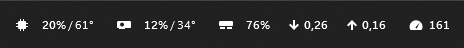
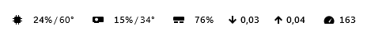

<p align="center">
  
</p>

<h1 align="center">Barline</h1>

<p align="center">
  CPU, GPU, RAM, network and FPS — on top of everything, even fullscreen games and movies.<br>
  Barline adapts to whatever is behind it, so the numbers are always readable.
</p>

<p align="center">
  <a href="https://github.com/Zimoffski/Barline/releases/latest"></a>
  <a href="LICENSE"></a>
  
  <a href="https://github.com/Zimoffski/Barline/actions/workflows/build.yml"></a>
</p>

<p align="center"><a href="README.ru.md">Русская версия</a></p>

<p align="center">
  <br>
  <sub>On the taskbar</sub>
</p>
<p align="center">
  <br>
  <sub>Over a white fullscreen app — the text switches to black by itself</sub>
</p>

## Always on top. Always readable.

Barline stays above every window, including fullscreen games and movies, so your numbers are always one glance away.

Behind it can be anything: a dark game scene, a bright sky, a white document. Fifteen times a second Barline looks at the background and switches its text between white and black to keep the contrast right, without flickering on mid-tones. Temperature warnings stay orange and red on any background.

## Features

- **CPU, GPU and RAM load** with CPU and GPU temperatures. Temperatures turn orange from 70° and red from 85°.
- **FPS of the active app** — games, browsers, video players — measured with Intel PresentMon, without injecting anything into the game.
- **Network traffic** in Mbit/s, download first, from the physical adapter (VPN tunnels do not distort it).
- **Looks like part of Windows**: the system font of the clock and tray, monochrome icons, transparent background, light and dark taskbar.
- **Nothing jumps**: every icon and value has a fixed place, so the strip stays still while numbers change.
- **Lightweight**: under 2% of one CPU core, no background services, no network connections, no telemetry.

## Download

Get the installer from [Releases](https://github.com/Zimoffski/Barline/releases/latest) and run `Barline-<version>-Setup.exe`.

The installer:

- installs Barline into `Program Files\Barline` and adds a Start menu shortcut;
- enables autostart with access to hardware sensors;
- registers a normal uninstaller in **Settings → Apps**.

> **Windows SmartScreen.** Releases are not code-signed yet, so Windows may show “Windows protected your PC”. Choose **More info → Run anyway**. You can verify the file with the SHA-256 checksum published with each release.

### Sensor driver (PawnIO)

Reading the CPU temperature requires the official [PawnIO](https://github.com/namazso/PawnIO) driver. If it is missing, the installer asks a separate question and installs the bundled official PawnIO 2.2.0 only if you answer **Yes**. If you answer **No**, Barline still works, but the CPU temperature may show `—`. PawnIO is a shared system driver used by other monitoring tools, so it is not removed together with Barline.

## Usage

Barline lives in the system tray. Right-click its icon:

| Menu item | What it does |
|---|---|
| Hide / Show panel | Hides or shows the strip on the taskbar. |
| Show above all windows | On by default: the strip stays visible over fullscreen games and video. Off: it hides together with the taskbar. |
| Start with Windows | Turns autostart on or off. |
| Get access to temperature and FPS… | Restarts Barline once with administrator rights and sets up autostart with sensor access. |
| Sensor diagnostics… | Writes a report of every sensor Barline can see — attach it to bug reports. |
| Exit | Closes Barline. |

The interface is in English or Russian, following the Windows display language.

## FAQ

**Why does Barline need administrator rights?**
Windows only exposes CPU temperature sensors and the frame-timing events used for FPS to elevated processes. Barline gets them through a Task Scheduler entry created by the installer, so there is no UAC prompt at every logon. Without administrator rights Barline still runs; temperature and FPS then show `—`.

**Why does FPS show `—`?**
The active window draws no new frames: the desktop, File Explorer or a static page. Apps redraw only when something changes, so typing in a text editor really is 3–5 frames per second. Games and video show their real frame rate.

**Is the network value in megabits or megabytes?**
Always megabits per second, the unit internet providers and speed tests use: `0.12` · `9.35` · `93.4` · `934`. The decimal separator follows your Windows regional settings.

**Does Barline send any data anywhere?**
No. Barline makes no network connections and collects no telemetry. All values are read locally.

**My antivirus complains.**
Hardware monitors need low-level sensor access, which some antivirus heuristics dislike. The full source code is here; you can build the installer yourself (see below) and compare checksums.

## How it works

Barline is a small .NET 8 WPF overlay window attached to the taskbar. Sensors are read by [LibreHardwareMonitor](https://github.com/LibreHardwareMonitor/LibreHardwareMonitor); NVIDIA cards are read directly through the driver (NVML), which is about 500 times cheaper; FPS comes from [Intel PresentMon](https://github.com/GameTechDev/PresentMon). Details on layout, contrast, FPS and network measurement are in [docs/how-it-works.md](docs/how-it-works.md).

## Building from source

Requirements: Windows 10/11 x64, [.NET 8 SDK](https://dotnet.microsoft.com/download/dotnet/8.0), [Inno Setup 6.6+](https://jrsoftware.org/isdl.php).

```powershell
git clone https://github.com/Zimoffski/Barline.git
cd Barline
powershell -NoProfile -ExecutionPolicy Bypass -File .\scripts\Build-Release.ps1
```

The script downloads PresentMon and the PawnIO installer from their official releases, verifies the pinned SHA-256 checksums and signatures, checks code formatting, publishes the app and builds `Barline-<version>-Setup.exe` in the repository folder.

For development, `dotnet build` is enough. Run `scripts\Get-Dependencies.ps1` once if you also want FPS measurement.

## Uninstall

**Settings → Apps → Barline → Uninstall**. Settings, autostart entries and logs are removed. The PawnIO driver stays, because other software may use it.

## Contributing

Bug reports and ideas are welcome in [Issues](https://github.com/Zimoffski/Barline/issues). Please attach the report from **Sensor diagnostics…** for anything related to sensors. Security issues: see [SECURITY.md](SECURITY.md).

## License

Barline is released under the [MIT License](LICENSE). Third-party components, their licenses and source links are listed in [THIRD-PARTY-NOTICES.md](THIRD-PARTY-NOTICES.md); full license texts are in [`licenses`](licenses).
